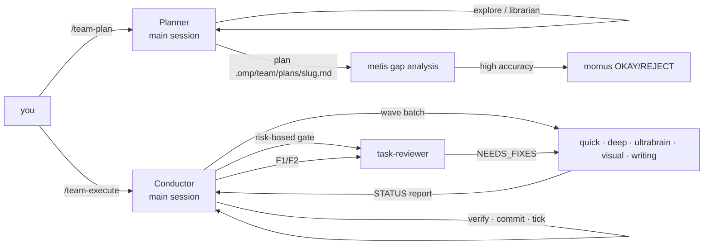

# omp-multi-agent

A multi-agent team for [oh-my-pi](https://github.com/can1357/oh-my-pi) (omp ≥ 18.13). Each role runs on its own model, across providers. Planning follows [oh-my-openagent](https://github.com/code-yeongyu/oh-my-openagent): an interview-driven planner, a gap-analysis critic, and a conductor that runs parallel waves. Execution follows [superpowers](https://github.com/obra/superpowers): workers report a status, every task passes a review gate, the fix loop escalates to stronger models, and every claim needs evidence.



## Install

This plugin ships in the `riegan-omp-plugins` marketplace (the repository root). See the [root README](../../README.md) for adding the marketplace, including private-repo access. Then:

```sh
omp plugin install omp-multi-agent@riegan-omp-plugins
```

From a local checkout, link the plugin directory:

```sh
omp plugin link plugins/omp-multi-agent
```

For a single session without installing: `omp -e plugins/omp-multi-agent`.

## Usage

| Command | What it does |
|---|---|
| `/team-plan [request]` | Turns on planner mode and switches the main session to the planner model. The planner explores, interviews you with `ask`, keeps a draft in `.omp/team/drafts/`, writes the plan to `.omp/team/plans/<slug>.md`, and runs `metis` on it (plus `momus` if you ask for high accuracy). It can only write under `.omp/team/`. |
| `/team-execute [slug]` | Restores your model and turns on conductor mode. The conductor runs the plan wave by wave: it delegates each task to its category agent, verifies the result, sends it to review, commits it, and ticks its checkbox. It keeps going until every checkbox is ticked. |
| `/team-status` | Shows the current mode and per-plan progress. |
| `/team-stop` | Leaves planner/conductor mode and stops continuation. |
| `/team-models` | Shows the model each agent resolves to, with its fallbacks. |
| `ultrawork` / `ulw` in a prompt | Adds the ultrawork orchestration prompt for that run: explore → todo → delegate by category → verify → don't stop. |

Execution state is kept in `.omp/team/`: `plans/`, `drafts/`, `notepads/<slug>/` (learnings, decisions, issues), and `boulder.json` (the active plan). After a restart, run `/team-execute` to resume; tasks that are already ticked are skipped.

### Continuation

While a plan is executing, the plugin checks the plan whenever the main agent stops. If any `- [ ] N.` / `- [ ] F#.` rows are still unticked, it sends the agent a nudge to continue. It stays quiet in these cases:
- you interrupted (Esc);
- the agent replied `TEAM_WAITING` because it is waiting on your answer;
- `maxStalledNudges` nudges in a row produced no newly ticked task.

## Roster and default models

| Agent | Role | Default chain (first available wins; later ones are retry fallbacks) |
|---|---|---|
| planner (main) | interview + plan | `@team-planner` → opus-5-5:xhigh → glm-5.3:max → gpt-6.1-sol:high |
| `explore` | codebase search | `@team-explore` → haiku-5-5:low → glm-5.3-flash:low → gpt-6-luna:low |
| `librarian` | external docs / OSS | `@team-librarian` → glm-5.3-flash:low → gpt-6-luna:low |
| `oracle` | read-only consultant | `@team-oracle` → gpt-6.1-sol:xhigh → glm-5.3:max → opus-5-5:xhigh |
| `metis` | plan gap analysis | `@team-critic` → gpt-6.1-sol:medium → glm-5.3:high → opus-5-5:high |
| `momus` | strict plan review | `@team-critic` → gpt-6-astra:high → glm-5.3:max → opus-5-5:high |
| `quick` | small, specified changes | `@team-quick` → glm-5.3-flash:high → haiku-5-5:high → gpt-6-luna:high |
| `deep` | standard implementation | `@team-deep` → sonnet-5-5:high → gpt-6-astra:high → glm-5.3:max |
| `ultrabrain` | hard logic | `@team-ultrabrain` → gpt-6-astra:high → gpt-6.1-sol:xhigh → glm-5.3:max → opus-5-5:xhigh |
| `visual` | UI/UX | `@team-visual` → opus-5-5:high → gpt-6-astra:medium → glm-5.3:max |
| `writing` | docs/prose | `@team-writing` → sonnet-5-5:medium → glm-5.3:high |
| `task-reviewer` | per-task + final review | `@team-reviewer` → gpt-6.1-sol:high |

The concrete defaults reference the providers `anthropic`, `rg_ai`, and `zai`. To remap a role without editing any file, set it in `~/.omp/agent/config.yml` (or use `/model` → Roles):

```yaml
modelRoles:
  team-deep: rg_ai/gpt-6-astra:high
  team-planner: anthropic/claude-opus-5-5:max
```

A configured `@team-*` role always goes first. `task.agentModelOverrides.<agent>` replaces an agent's whole chain.

Implementers autoload the bundled skills: `team-worker-protocol` (scope rules + `STATUS:` report), `team-test-driven-development`, `team-verification-before-completion`, and `team-systematic-debugging` (ultrabrain, oracle).

## Settings

Set these with `omp plugin config` (global) or `.omp/plugin-overrides.json` → `settings["omp-multi-agent"]` (per project):

| Key | Default | Meaning |
|---|---|---|
| `disabledProviders` | `""` | Comma-separated providers the team never routes to (e.g. `synthetic`). Matching entries are dropped from every team agent's chain at spawn time, and from the planner's. |
| `reviewPolicy` | `risk-based` | `risk-based`: tasks marked `Review: skip` (quick, no shared contract) skip the per-task reviewer. `always`: every task is reviewed. |
| `commitPolicy` | `per-task` | `per-task`: the conductor commits each verified task's files. `none`: nothing is committed. |
| `maxStalledNudges` | `3` | How many continuation nudges in a row without progress before giving up. |
| `ultraworkKeyword` | `true` | Turns the `ultrawork`/`ulw` keyword on or off. |
| `plannerSwitchModel` | `true` | Whether `/team-plan` switches the main model (and restores it afterwards). |

## Notes

- Any extension with a `tool_call` handler turns off omp's speculative task launch. This plugin needs that handler for the planner write guard.
- Subagents never commit, edit the plan, or spawn implementers. They can only spawn read-only `explore`/`librarian` (and `oracle` for `ultrabrain`).
- Development happens from the repository root: `bun install`, `bun test`, `bun run typecheck`.
