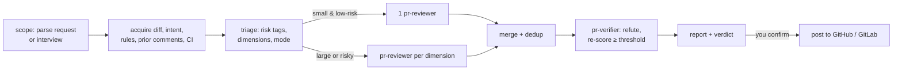

# omp-pr-review

High-precision PR review for [oh-my-pi](https://github.com/can1357/oh-my-pi) (omp ≥ 18.13). It reviews GitHub PRs, GitLab MRs, and uncommitted changes across security, correctness, performance, concurrency, structure, tests, and API/migrations. It also has conditional checklists for frontend/a11y, docs, dependencies/licensing, data privacy, and observability. A finding is reported only after an independent verifier has failed to refute it against the code.



## Install

```sh
omp plugin install omp-pr-review@riegan-omp-plugins
# or from a checkout:
omp plugin link plugins/omp-pr-review
```

Requires `git`. Install `gh` for GitHub and `glab` for GitLab, both authenticated.

## Usage

| Input | Effect |
|---|---|
| `/pr-review` | Infers the target (working tree, or the open PR/MR for the current branch). If it can't tell, it asks. |
| `/pr-review 123` · `/pr-review <PR or MR URL>` · `/pr-review !45` | Review that PR/MR. |
| `--focus security,performance` | Limit the review to these dimensions or checklists. |
| `--quick` / `--deep` | Quick: one finder. Deep: always fan out, one verifier per finding. |
| `--post` | Pre-selects posting. You still confirm the drafted comments first. |
| "security review my changes", "review PR 88 for perf" | The `pr-review` skill matches in plain chat and reads the scope from your wording. |

The review asks you only about scope fields that neither your request nor the repo answers, all in a single batched `ask`. If you answer "you pick", it uses the defaults.

**Output:** verdict (`Request changes` / `Approve with comments` / `Approve`), then findings sorted by severity. Each finding has `path:line`, confidence, a concrete trigger, and a fix. After that come intent compliance, the status of prior comments (RESOLVED / STILL PRESENT / OUTDATED), checks, what was checked, and **Declined** (what was considered and why it was set aside).

**Posting:** nothing is posted until you confirm. GitHub gets one `COMMENT` review with inline comments. GitLab gets one DiffNote per finding plus a summary note. Each comment carries a fingerprint, so re-reviews don't repeat earlier comments.

## How precision is enforced

- **Find, then refute.** Finders (`pr-reviewer`) must give location, quoted evidence, a concrete trigger, the consequence, and a fix. Verifiers (`pr-verifier`) try to disprove each finding and re-score it. Only findings with confidence ≥ 80 reach you.
- **Per-dimension exclusion lists**, for example security never reports DoS, rate limits, or theoretical races, and performance needs a realistic scale trigger.
- **Changed lines only.** Pre-existing issues are never reported. Inputs (PR text, comments, CI logs) are treated as untrusted data, which guards against prompt injection.
- **Model inversion.** Reviewer chains prefer a different model family than your session model, since that is likely the author's model.

## Project rules: `REVIEW.md`

Put `REVIEW.md` (or `.omp/review.md`) at the repo root. `AGENTS.md`/`CLAUDE.md` along changed paths are honored too, scoped to their directory.

```markdown
---
threshold: 80
fanout: { lines: 400, files: 10 }
ignore: ["gen/**", "**/*.snap"]
dimensions: [security]
severity: { "missing authz": Critical }
---
- All DB access goes through `repo/` helpers; no raw SQL in handlers.
- Public HTTP handlers must call `requireTenant(ctx)`.
```

A violation of a body rule is reported with the rule quoted.

## Models

| Agent | Role | Default chain |
|---|---|---|
| `pr-reviewer` | finder | `@pr-review` → gpt-6.1-sol:high → opus-5-5:high → glm-5.3:max |
| `pr-verifier` | refuter | `@pr-verify` → gpt-6-astra:high → sonnet-5-5:high → glm-5.3:high |

With `modelInversion` on (the default), models from a different family than the session model move to the front. A configured `modelRoles.pr-review` / `pr-verify` always wins:

```yaml
modelRoles:
  pr-review: rg_ai/gpt-6.1-sol:xhigh
  pr-verify: anthropic/claude-sonnet-5-5:high
```

## Settings

`omp plugin config`, or `.omp/plugin-overrides.json` → `settings["omp-pr-review"]`:

| Key | Default | Meaning |
|---|---|---|
| `disabledProviders` | `""` | Comma-separated providers the reviewer agents never use. |
| `modelInversion` | `true` | Prefer cross-family reviewer models. |

## Layout

```
skills/pr-review/SKILL.md            orchestrator (the only listed skill)
skills/pr-review/references/         acquire (gh/glab/git), report template, posting
skills/pr-review/dimensions/<dim>.md          method · flag · do-not-flag · severity anchors
skills/pr-review/dimensions/<dim>/<lang>.md   typescript · go · python · rust · sql pitfalls
skills/pr-review/checklists/         frontend-a11y · docs · dependencies · data-privacy · observability
skills/pr-review-protocol/SKILL.md   hidden; evidence bar, confidence, severity, finding format
agents/pr-reviewer.md, pr-verifier.md
src/                                 /pr-review command, reviewer model routing
```

Only `pr-review` appears in the system prompt. Dimension and language files are read only when triage selects them.
